# Quill mark

A glowing line-art quill that draws itself in, then lights a grainy pool of light on the surface under its nib. It's designed for a dark background (`#28271f`); the glow doesn't show on a light one.

## Files
- `quill-animated.svg`: draws itself in once (about 3.3s). Then the light under the nib spreads out (about 1.4s), and it stays like that.
- `quill.svg`: the finished quill, no animation.
- `quill-no-nib-glow-animated.svg` and `quill-no-nib-glow.svg`: the same two without the light under the nib.
- `quill.html`: a demo page. Open it in a browser. "Nib glow" switches between the two versions, and "Replay" plays it again.
- `build/`: the scripts and data that make the files above. See "Changing the quill".

All four SVGs are self-contained: no other files, fonts or JavaScript. The versions with the nib glow are 354 × 388 by default, because the light needs room to the left of and below the nib. The versions without it are 314 × 380. Set the width and the height follows. To show the quill at the same size in both, give the glow version 354/314 (about 1.13) times the width.

## As an image (simplest)
```html

```
Use `quill.svg` for the still version. To also give a still quill to people who've turned on reduced motion:
```html
<picture>
  <source srcset="quill.svg" media="(prefers-reduced-motion: reduce)">
  
</picture>
```
To replay it, add a fresh ``. In React, change its `key`.

## Inline (paste the SVG into the page)
Paste the whole contents of the file in place of the ``. This lets your code restart it, and reduced motion is handled automatically.
- Its class names, CSS variables and animation names all start with `q-`, and its styles only apply inside the quill. So it and your page's styles don't affect each other.
- Size: `.q-quill { width: 200px; height: auto; }`
- Replay: replace the `<svg>` with a copy of itself, `svg.replaceWith(svg.cloneNode(true))`.
- React with Vite: `import quill from './quill-animated.svg?raw'`, then `<div dangerouslySetInnerHTML={{ __html: quill }} />`.

## Changing the quill
Needs Python 3 with Pillow (`pip install pillow`). From `build/`:
```
python fix.py
python final2.py
```
`fix.py` joins the traced lines into `refined.json`, and `final2.py` writes the four SVGs and `quill.html` next to `build/`. Colours, line weights and timings are set at the top of `final2.py`, and the light pool's size, shape and grain next to `POOL_RX`. Each line's shade is worked out from the main colours, so change colours there and rebuild rather than editing the SVG.

Checks: `final2.py` prints how closely the quill matches `reference.png` and saves comparison images to `build/checks/`. `python review.py` lists line ends that touch nothing, and `python shaftcheck.py` measures the shaft's smoothness, taper and line weight.
